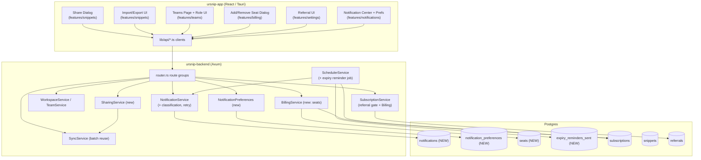
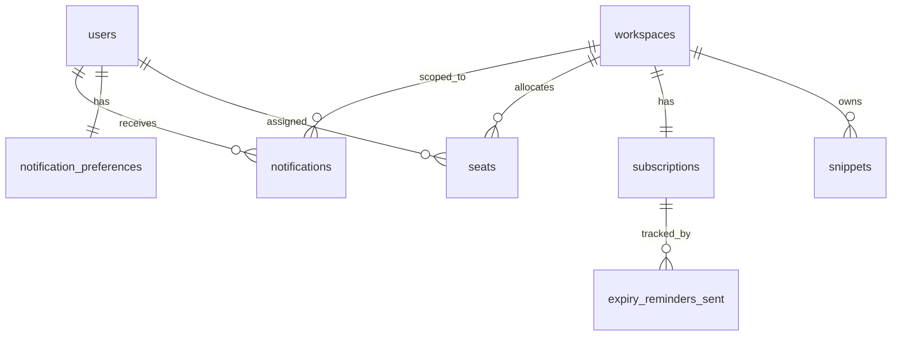

# Design Document: UrSnip Feature Matrix

## Overview

The UrSnip Feature Matrix is a cross-stack initiative closing seven feature gaps across the `ursnip-backend` (Rust / Axum / sqlx / Postgres) and `ursnip-app` (React / TanStack Router / Tauri) codebases. This design grounds every proposal in the existing code so that new migrations, endpoints, services, and UI follow established conventions rather than introducing parallel patterns.

The seven areas and their nature:

| # | Feature | Nature | Primary work |
|---|---------|--------|--------------|
| 1 | Snippet Sharing | Missing | New backend `SharingService` + share dialog |
| 2 | Import & Export (JSON) | Missing | Reuse `POST /sync/snippets/batch` for import; frontend file export |
| 3 | Workspace CRUD | Mostly done | Confirm/round out edge cases only |
| 4 | Team Invite & Role Management | Partial (frontend) | Email invites, role-change UI, live teams page |
| 5 | Referral Pro/Team Gate | Partial (backend) | Enforce paid-tier gate in `record_referral` |
| 6 | Billing & Seat Management | Largely missing | New `seats` table + add/remove flows + UI |
| 7 | Notifications | Partial + latent defect | Create missing `notifications` table, triggers, scheduler, preferences |

The single most urgent item is Feature 7's latent defect: `NotificationService::create` and `notify_workspace_members` both `INSERT INTO notifications`, but no migration ever created that table, so every notification write fails today. The design fixes this first, then builds classification and preferences on top.

### Grounding summary (what already exists)

- **Migrations** run `0001`–`0014`, numbered `NNNN_name.sql`. New tables use plain `CREATE TABLE`; additive columns use `ADD COLUMN IF NOT EXISTS` (see `0008_seats.sql`, `0014_snippet_flags.sql`). Table-add migrations sometimes use `CREATE TABLE IF NOT EXISTS` (see `0003`, `0007`).
- **Subscriptions** (`migrations/0001`, extended by `0007`/`0008`) are **workspace-scoped** (`idx_subscriptions_workspace` is unique on `workspace_id`). Columns include `tier`, `status`, `period_start`, `period_end`, `grace_period_end`, `payment_deadline`, `max_seats`, `extra_seats_purchased`. There is **no per-seat model** — only integer counts.
- **`add_seats_handler`** (`POST /subscriptions/add-seats`) currently takes `{ workspace_id, seats: i32 }` and bumps `max_seats`/`extra_seats_purchased` (dev path) or opens a Paddle transaction. It has **no duration/expiry** concept.
- **`NotificationService`** already writes `user_id, workspace_id, event_type, title, description, metadata (jsonb), is_read, created_at` and reads with `SELECT *`. It exposes `create`, `notify_workspace_members`, `list`, `mark_read`, `mark_all_read`, plus a fire-and-forget `persist_notification_async`.
- **`SubscriptionService::record_referral`** validates the referral coupon, self-referral, and duplicates, then inserts `referrals(status='pending')` — but never checks the referrer's tier. This is the gate to add.
- **Scheduler** (`SchedulerService`) registers recurring jobs via `spawn_task(name, interval, shutdown_rx, |svc| ...)` with built-in retry/backoff and timestamp-based idempotence. New expiry-reminder job plugs in here.
- **Batch endpoint** `POST /sync/snippets/batch` (`batch_operations_handler` → `SyncService::batch_operations`) enforces trigger uniqueness, tier content-size limits (UTF-16 code units), requires Pro/Teams, and is workspace-scoped via `workspace_context_guard`. Import reuses this.
- **Frontend** API clients live in `src/lib/api/*.ts` (thin `apiClient` wrappers). Features live in `src/features/*`. `src/features/teams/data/teams.ts` holds the mock data to replace.

---

## Architecture



New backend modules follow the existing `src/<domain>/{mod.rs, service.rs, handlers.rs}` layout:
- `src/sharing/` — Feature 1
- `src/billing/` — Feature 6 (per-seat), distinct from the existing `subscription` module which stays focused on tier/checkout
- Feature 7 extends the existing `src/notifications/` module and adds a `preferences.rs`.

Route groups are added to `router.rs` inside `authenticated_routes`, matching the existing `notification_routes` / `subscription_routes` construction (Extension-injected `Arc<Service>`, `workspace_context_guard` where workspace-scoped).

---

## Components and Interfaces

### Feature 1: Snippet Sharing (`src/sharing/`)

**`SharingService`** creates an independent recipient-owned copy. It reuses the recipient lookup and the same trigger-uniqueness / content-limit rules already enforced by `SyncService`.

```rust
pub struct SharingService { pool: PgPool, sync: Arc<SyncService> }

pub struct ShareRequest {
    pub source_snippet_id: Uuid,
    pub recipient: String,          // email or user id (resolved via existing lookup)
    pub target_workspace_id: Uuid,  // recipient's target workspace
}

impl SharingService {
    /// Req 1.1–1.5, 2.1–2.3
    pub async fn share_snippet(
        &self,
        requester_id: Uuid,
        req: ShareRequest,
    ) -> Result<SharedCopy, AppError>;
}
```

Logic (all in one transaction):
1. Load source snippet; if requester lacks read access → `AppError` authorization error (Req 1.5).
2. Resolve recipient via the existing user-lookup mechanism (same query used by `lookup_users_handler`, extended to allow email lookup). If unresolved → recipient-not-found error, no write (Req 1.4).
3. Copy `trigger` + `content` (and `snippet_type`, `ai_prompt`) into a **new** `snippets` row owned by the recipient's target workspace, with `created_by = recipient_id`. This is a value copy — no FK to the source — so later edits to the source do not touch the copy (Req 1.2).
4. Reuse `SyncService`'s trigger-uniqueness check and tier content-size enforcement against the recipient's workspace; on conflict return a trigger-conflict error naming the trigger (Req 2.1, 2.2), on oversize return content-too-long (Req 2.3).
5. Record a sync delta + emit a share notification to the recipient (Feature 7).

**Endpoint:** `POST /sharing/snippets`
```
Body: { source_snippet_id, recipient, target_workspace_id }
200:  { snippet_id, recipient_id, trigger }
404:  recipient not found
409:  trigger conflict (includes conflicting trigger)
403:  not authorized to read source
```
Registered in a new `sharing_routes` group with `Extension(Arc<SharingService>)`. Recipient's workspace membership is validated inside the service (the source workspace is guarded by `workspace_context_guard`).

### Feature 2: Import & Export

**Import** reuses `POST /sync/snippets/batch` end-to-end rather than adding a new ingestion path (Req 4.2). The import is orchestrated client-side plus a thin parse/validate helper:

- Parsing/validation of the JSON payload into candidate snippets happens in a small `ImportService::parse(payload) -> Result<Vec<CandidateSnippet>, ParseError>` (Req 4.1, 4.6). This can live in `src/sync/` next to the batch types since it produces `BatchOperation::CreateSnippet` values.
- Ingestion maps each candidate to `BatchOperation::CreateSnippet(CreateSnippetPayload { workspace_id, trigger, content, snippet_type, folder_id: None, ai_prompt })` and posts to the batch endpoint, which already enforces trigger uniqueness, prefix-conflict, and content-size limits (Req 4.3–4.5). Per-item violations are surfaced from the existing `BatchItemResult` results array (Req 4.7).

**Export** is a frontend/Tauri responsibility (Req 5.1–5.3): serialize the selected snippets (or the whole workspace snapshot from `GET /sync/snapshot`) to a JSON document and write it to the local device via Tauri's file APIs. The JSON schema mirrors the import candidate schema so round-trip holds (Req 6.1).

**Canonical JSON schema (export output = import input):**
```json
{
  "version": 1,
  "workspace_name": "optional",
  "snippets": [
    { "trigger": "string", "content": "string", "snippet_type": "string", "ai_prompt": "string|null" }
  ]
}
```
`id`, `version`, `created_at`, `workspace_id` are intentionally excluded: they are environment-specific and regenerated on import, which is exactly why round-trip fidelity is defined over `{trigger, content}` (and `snippet_type`, `ai_prompt`) rather than identity fields (Req 6.1).

### Feature 3: Workspace CRUD (confirmation only)

No new components. The design confirms existing behavior in `WorkspaceService` (`list_user_workspaces`, `create_team_workspace`, `update_workspace`, `delete_workspace`, `verify_membership`) already satisfies Req 7 and Req 8:
- Empty-name rejection: `update_workspace` already ignores empty names; create paths validate name. Req 8.1 is covered by a validation guard in the create/update handlers (confirm and add explicit `AppError::InvalidRequestBody` on empty for update rather than silent no-op).
- Ownership/authorization and not-found errors are enforced via `workspace_context_guard` + `WorkspaceNotFound` (Req 8.2, 8.3).

This feature is validated with existing example/integration tests; no new schema.

### Feature 4: Team Invite & Role Management (frontend only)

Backend endpoints are reused as-is:
- Email invite: `POST /teams/:workspace_id/invites` (extend body to carry `email` and send via existing email service path already used by collaborator invites).
- Role list/change: `GET/PATCH /teams/:workspace_id/members/:user_id/permissions` (existing `get_member_permissions_handler` / `update_member_permissions_handler`).
- Member list/remove: `GET /teams/:workspace_id/members`, `DELETE /teams/:workspace_id/members/:user_id`.

Frontend work: email-invite form with validation, role dropdown per member wired to the permissions API, and replacing `features/teams/data/teams.ts` mock data with `listMembers()` from `lib/api/workspaces.ts`.

### Feature 5: Referral Pro/Team Gate

The gate is added **inside `SubscriptionService::record_referral`**, before the referral row is inserted (Req 12.1–12.4). This is the single call site (confirmed via search) and keeps the rule server-side and authoritative.

```rust
// After resolving referrer_id, before the duplicate check / INSERT:
let referrer_tier: Option<String> = sqlx::query_scalar(
    r#"
    SELECT s.tier
    FROM subscriptions s
    JOIN workspaces w ON w.id = s.workspace_id
    WHERE w.owner_id = $1 AND w.type = 'individual'
      AND s.status = 'active'
    "#,
).bind(referrer_id).fetch_optional(&self.pool).await?;

match referrer_tier.as_deref() {
    Some("pro") | Some("teams") => { /* proceed */ }
    _ => return Err(AppError::ReferrerNotOnPaidPlan), // new variant
}
```
- Free tier or no active subscription → `ReferrerNotOnPaidPlan`, no referral row created (Req 12.2, 12.3).
- Reward allotment/claim flow (Req 13) is unchanged — `convert_referral` / `apply_referral_reward` already grant +1 month to both parties, are idempotent on `status='converted'`, and use `referral_credits(redeemed)` for deferred claims.

Frontend surfaces the `ReferrerNotOnPaidPlan` error as an upgrade message (Req 14.1) and keeps the action in a rejected-pending state on technical failure (Req 14.2).

### Feature 6: Billing & Seat Management (`src/billing/`)

**`BillingService`** owns the new per-seat model. `add_seats_handler` is refactored to delegate to it (or a new `POST /subscriptions/seats` endpoint is added alongside; see Design Decisions).

```rust
pub enum SeatDuration { Months(u8 /* 1|2|3|6 */), UntilPlanLasts }

pub struct AddSeatRequest {
    pub workspace_id: Uuid,
    pub duration: SeatDuration,
    pub assigned_user_id: Option<Uuid>,
}

impl BillingService {
    /// Req 15.1–15.3, 16.1–16.4, 17.1–17.4
    pub async fn add_seat(&self, admin_id: Uuid, req: AddSeatRequest) -> Result<Seat, AppError>;
    /// Req 18.1–18.4
    pub async fn remove_seat(&self, admin_id: Uuid, seat_id: Uuid) -> Result<(), AppError>;
    pub async fn list_seats(&self, workspace_id: Uuid) -> Result<Vec<Seat>, AppError>;
}
```

Seat-expiry computation (Req 15.2, 15.3, 16.1–16.3):
```rust
let now = Utc::now();
let period_end = sub.period_end.ok_or(AppError::InvalidRequestBody)?;
let expiry = match req.duration {
    SeatDuration::Months(n) => now.checked_add_months(Months::new(n as u32)).unwrap(),
    SeatDuration::UntilPlanLasts => period_end,
};
// Inclusive boundary (Req 16.3): reject only when strictly greater.
if expiry > period_end {
    return Err(AppError::SeatExceedsPaidPeriod); // new variant
}
```
`chrono::Months` is already imported/used in `subscription/service.rs`, so month math is consistent with existing referral extensions.

**Endpoints** (workspace-scoped, `check_role_owner`):
- `POST /subscriptions/seats` → add seat with duration.
- `DELETE /subscriptions/seats/:seat_id` → remove seat.
- `GET /subscriptions/seats?workspace_id=...` → list seats.

The legacy `POST /subscriptions/add-seats` (integer count) remains for backward compatibility but is superseded by the per-seat endpoint; the frontend switches to the new endpoint.

### Feature 7: Notifications

**Fix + extend `NotificationService`.** Existing `create` / `notify_workspace_members` keep their signatures; `CreateNotification` gains a `classification` field defaulting to `system`. Retry (Req 20.3) is added by wrapping the insert in a bounded retry loop (mirroring the scheduler's 3-attempt policy) before surfacing failure. System triggers are wired at their event sites:

- Workspace invite sent/received → `create` for sender and receiver (Req 21).
- Subscription activation → `create` for owner, non-blocking (Req 22.2) via `persist_notification_async`.
- Device register/remove → `create`, non-blocking (Req 24.2).
- Promotional broadcast → admin endpoint fanning out to opted-in users (Req 25).

**`NotificationPreferences`** (`src/notifications/preferences.rs`):
```rust
pub struct NotificationPreferences {
    pub user_id: Uuid,
    pub system_enabled: bool,       // Req 26.2
    pub promotional_enabled: bool,  // Req 26.2
    pub security_system_enabled: bool, // Req 26.5, 26.6 (default true)
}
```
Endpoints: `GET /notifications/preferences`, `PUT /notifications/preferences`.

**Expiry reminder scheduler** plugs into `SchedulerService` as a new `spawn_task("expiry_reminder_check", …)` running hourly. Idempotence per threshold (Req 23.3) is tracked by a dedicated `expiry_reminders_sent` marker table (chosen over a JSON column on subscriptions — see Design Decisions).

---

## Data Models

All migrations continue the numbering after `0014` and follow existing style. New standalone tables use `CREATE TABLE IF NOT EXISTS`; additive columns use `ADD COLUMN IF NOT EXISTS`.

### `0015_notifications.sql` — Fix latent defect (Req 20, 25)

```sql
-- Migration: 0015_notifications.sql
-- Description: Create the notifications table. NotificationService already writes
--              user_id, workspace_id, event_type, title, description, metadata,
--              is_read, created_at (see notifications/service.rs), but no migration
--              ever defined the table, so every notification write fails today.
--              Adds a `classification` column to split system vs promotional (Req 25).

CREATE TABLE IF NOT EXISTS notifications (
    id             UUID PRIMARY KEY DEFAULT gen_random_uuid(),
    user_id        UUID NOT NULL REFERENCES users(id) ON DELETE CASCADE,
    workspace_id   UUID NOT NULL REFERENCES workspaces(id) ON DELETE CASCADE,
    event_type     TEXT NOT NULL,
    title          TEXT NOT NULL,
    description    TEXT,
    metadata       JSONB NOT NULL DEFAULT '{}'::jsonb,
    classification TEXT NOT NULL DEFAULT 'system'
                   CHECK (classification IN ('system', 'promotional')),
    is_read        BOOLEAN NOT NULL DEFAULT FALSE,
    created_at     TIMESTAMPTZ NOT NULL DEFAULT now()
);

-- List/unread queries in service.rs filter by user_id and order by created_at DESC.
CREATE INDEX IF NOT EXISTS idx_notifications_user_created
    ON notifications (user_id, created_at DESC);
CREATE INDEX IF NOT EXISTS idx_notifications_user_unread
    ON notifications (user_id) WHERE is_read = FALSE;
```
Column set matches `NotificationService` exactly (which uses `SELECT *` and `#[derive(FromRow)] Notification`); `classification` is additive with a default so existing insert statements keep working, and the `Notification` struct + insert queries gain the field.

### `0016_notification_preferences.sql` — (Req 26)

```sql
-- Migration: 0016_notification_preferences.sql
-- Description: Server-side notification preferences (previously localStorage-only).
--              Separate opt-in/out for system vs promotional, plus an explicit
--              security-system toggle that defaults ON and requires confirmation
--              to disable (Req 26.5, 26.6).

CREATE TABLE IF NOT EXISTS notification_preferences (
    user_id                 UUID PRIMARY KEY REFERENCES users(id) ON DELETE CASCADE,
    system_enabled          BOOLEAN NOT NULL DEFAULT TRUE,
    promotional_enabled     BOOLEAN NOT NULL DEFAULT TRUE,
    security_system_enabled BOOLEAN NOT NULL DEFAULT TRUE,
    created_at              TIMESTAMPTZ NOT NULL DEFAULT now(),
    updated_at              TIMESTAMPTZ NOT NULL DEFAULT now()
);
```
Absence of a row = all defaults (opted in). `PUT` upserts with `ON CONFLICT (user_id) DO UPDATE`.

### `0017_seats.sql` — Per-seat duration/expiry (Req 15, 16, 17, 18)

```sql
-- Migration: 0017_seats.sql
-- Description: Per-seat duration/expiry model for Teams. The existing schema only
--              tracks integer counts (subscriptions.max_seats / extra_seats_purchased);
--              this adds individual seat rows so each seat has its own expiry and can
--              be assigned/removed. Enforces seat_expiry <= subscription.period_end in
--              the application (BillingService), the boundary being inclusive.

CREATE TABLE IF NOT EXISTS seats (
    id               UUID PRIMARY KEY DEFAULT gen_random_uuid(),
    workspace_id     UUID NOT NULL REFERENCES workspaces(id) ON DELETE CASCADE,
    assigned_user_id UUID REFERENCES users(id) ON DELETE SET NULL,  -- nullable: unassigned seat
    duration_option  TEXT NOT NULL
                     CHECK (duration_option IN ('1m','2m','3m','6m','until_plan_lasts')),
    seat_start       TIMESTAMPTZ NOT NULL DEFAULT now(),
    seat_expiry      TIMESTAMPTZ NOT NULL,
    created_at       TIMESTAMPTZ NOT NULL DEFAULT now()
);

CREATE INDEX IF NOT EXISTS idx_seats_workspace ON seats (workspace_id);
CREATE INDEX IF NOT EXISTS idx_seats_assigned ON seats (assigned_user_id) WHERE assigned_user_id IS NOT NULL;
CREATE INDEX IF NOT EXISTS idx_seats_expiry ON seats (seat_expiry);
```
The `seat_expiry <= period_end` invariant is enforced in `BillingService` (application-level) rather than a DB `CHECK`, because `period_end` lives on the related `subscriptions` row and would require a trigger to enforce declaratively. The `duration_option` enum values map 1:1 to the frontend stepper + radio.

### `0018_expiry_reminders_sent.sql` — Idempotence marker (Req 23.3)

```sql
-- Migration: 0018_expiry_reminders_sent.sql
-- Description: Marker table so the expiry-reminder scheduler emits at most one
--              plan-expiry notification per subscription per day-threshold
--              (30/15/7/3/1). A unique constraint makes the guard atomic and
--              idempotent across restarts.

CREATE TABLE IF NOT EXISTS expiry_reminders_sent (
    id              UUID PRIMARY KEY DEFAULT gen_random_uuid(),
    subscription_id UUID NOT NULL REFERENCES subscriptions(id) ON DELETE CASCADE,
    period_end      TIMESTAMPTZ NOT NULL,          -- ties the marker to a specific paid period
    threshold_days  INTEGER NOT NULL CHECK (threshold_days IN (30,15,7,3,1)),
    sent_at         TIMESTAMPTZ NOT NULL DEFAULT now()
);

CREATE UNIQUE INDEX IF NOT EXISTS idx_expiry_reminders_unique
    ON expiry_reminders_sent (subscription_id, period_end, threshold_days);
```
Including `period_end` in the uniqueness key means a renewal (new `period_end`) legitimately re-arms all thresholds, while re-runs within the same period are suppressed.

### Data model relationships



---

## Correctness Properties

*A property is a characteristic or behavior that should hold true across all valid executions of a system — essentially, a formal statement about what the system should do. Properties serve as the bridge between human-readable specifications and machine-verifiable correctness guarantees.*

Properties below are derived from the prework analysis. UI wiring/rendering criteria, migration/setup checks, and criteria already covered by existing tests (referral reward idempotence, batch-endpoint rule enforcement) are intentionally excluded and handled by example/integration/smoke tests in the Testing Strategy.

### Feature 1: Snippet Sharing

### Property 1: Shared copy preserves data and is independent of the source

*For any* source snippet and any resolvable recipient with a conflict-free target workspace, sharing SHALL create a recipient-owned snippet whose trigger and content equal the source's, AND subsequent edits to the source snippet SHALL NOT change the recipient's copy.

**Validates: Requirements 1.1, 1.2**

### Property 2: Unresolvable recipient creates no snippet

*For any* recipient identifier that does not resolve to an existing user, a share request SHALL be rejected with a recipient-not-found error AND the number of snippets in every workspace SHALL be unchanged.

**Validates: Requirements 1.4**

### Property 3: Trigger conflict rejects the copy

*For any* recipient target workspace already containing a trigger T, sharing a snippet whose trigger is T SHALL be rejected with a trigger-conflict error identifying T AND no copy SHALL be created.

**Validates: Requirements 2.1, 2.2**

### Feature 2: Import & Export

### Property 4: Export/import round-trip fidelity

*For any* set of snippets exported by the Export_Service, importing the exported JSON document into an empty workspace SHALL produce snippets whose triggers and content (and snippet_type and ai_prompt) are equivalent to the exported snippets.

**Validates: Requirements 6.1, 4.1, 5.1**

### Property 5: Invalid import payload ingests nothing

*For any* payload that is not valid JSON or does not conform to the expected snippet schema, the Import_Service SHALL reject the import with a parse error AND SHALL ingest zero snippets.

**Validates: Requirements 4.6**

### Property 6: Whole-workspace export completeness

*For any* workspace, an export selecting the entire workspace SHALL produce a JSON document containing exactly every non-deleted snippet in that workspace.

**Validates: Requirements 5.1, 5.3**

### Feature 3: Workspace

### Property 7: Empty workspace names are rejected

*For any* workspace name consisting solely of whitespace (including the empty string), a create or update request SHALL be rejected with a validation error AND the workspace name SHALL NOT be persisted.

**Validates: Requirements 8.1**

### Feature 5: Referral

### Property 8: Referral requires an active paid referrer

*For any* referrer whose subscription tier is `free` or who has no active subscription, recording a referral SHALL be rejected with a "referrer not on paid plan" error AND the number of referral records SHALL be unchanged.

**Validates: Requirements 12.2, 12.3**

### Property 9: Eligible referrer records a pending referral

*For any* referrer with an active `pro` or `teams` subscription and a valid, non-self, non-duplicate referee, recording a referral SHALL create exactly one referral record with status `pending`.

**Validates: Requirements 12.1, 12.4**

### Feature 6: Billing & Seat Management

### Property 10: Seat expiry never exceeds the paid period (inclusive boundary)

*For any* add-seat request that results in a created seat, the created `seat_expiry` SHALL satisfy `seat_expiry <= subscription.period_end`; and when a computed expiry equals `period_end` exactly, the seat SHALL be created (the boundary is inclusive).

**Validates: Requirements 16.1, 16.3, 16.4, 15.1**

### Property 11: Over-period fixed durations create no seat

*For any* fixed Seat_Duration_Option whose computed expiry (seat start plus N months) is strictly greater than `subscription.period_end`, the add-seat request SHALL be rejected with a "seat exceeds paid period" error AND no seat SHALL be created.

**Validates: Requirements 16.2**

### Property 12: Fixed-duration expiry equals start plus N months

*For any* seat created with a fixed Seat_Duration_Option of N months (N in {1,2,3,6}) that is within the paid period, the `seat_expiry` SHALL equal the seat start time plus N months.

**Validates: Requirements 15.2**

### Property 13: "Until plan lasts" expiry equals the period end

*For any* seat created with the "until plan lasts" option, the `seat_expiry` SHALL equal the Team `subscription.period_end`.

**Validates: Requirements 15.3**

### Property 14: Add and remove change usable allocation by one

*For any* Team subscription, a successful add-seat SHALL increase the usable seat allocation by exactly one, and a successful remove-seat SHALL decrease it by exactly one.

**Validates: Requirements 17.2, 18.1**

### Property 15: Unsupported durations create no seat

*For any* add-seat request whose duration is missing or is not one of the supported Seat_Duration_Options, the request SHALL be rejected with a validation error AND no seat SHALL be created.

**Validates: Requirements 17.4**

### Property 16: Assigned seats cannot be removed until cleared

*For any* seat currently assigned to a Team_Member, a remove-seat request SHALL be rejected with a "seat in use" error; after the assignment is cleared, removal of that seat SHALL succeed.

**Validates: Requirements 18.3**

### Feature 7: Notifications

### Property 17: Notification persistence round-trip

*For any* valid notification written via the Notification_Service after the migration is applied, listing that user's notifications SHALL return a notification with equal user_id, workspace_id, event_type, title, description, and metadata.

**Validates: Requirements 20.2**

### Property 18: Expiry reminders fire exactly at the day thresholds

*For any* active paid subscription evaluated by the Expiry_Reminder_Scheduler, a plan-expiry notification SHALL be created if and only if the whole number of days between evaluation time and `period_end` is one of {30, 15, 7, 3, 1}.

**Validates: Requirements 23.1, 23.2**

### Property 19: Expiry reminders are idempotent per threshold

*For any* subscription, paid period, and day threshold, running the Expiry_Reminder_Scheduler any number of times SHALL result in at most one plan-expiry notification for that (subscription, period_end, threshold) combination.

**Validates: Requirements 23.3**

### Property 20: Promotional notifications respect opt-out

*For any* set of targeted users with arbitrary promotional preferences, issuing a promotional broadcast SHALL create a promotional notification for a user if and only if that user has not opted out of promotional notifications.

**Validates: Requirements 25.1, 26.4**

### Property 21: Every notification is classified

*For any* notification created by the Notification_Service, its classification SHALL be exactly one of `system` or `promotional`.

**Validates: Requirements 25.2**

### Property 22: Preferences persistence round-trip

*For any* notification-preferences payload, persisting it via the preferences endpoint and then retrieving it SHALL return equal `system_enabled`, `promotional_enabled`, and `security_system_enabled` values.

**Validates: Requirements 26.1, 26.2**

### Property 23: System opt-out preserves expiry and security notifications

*For any* user who has opted out of system notifications but has NOT explicitly disabled security-relevant system notifications, the Notification_Service SHALL still create plan-expiry and security-relevant device notifications for that user.

**Validates: Requirements 26.5**

---

## Error Handling

New `AppError` variants (added to `src/errors.rs`, mapped to HTTP status like existing variants):

| Variant | HTTP | Used by |
|---------|------|---------|
| `RecipientNotFound` | 404 | Sharing (Req 1.4) |
| `TriggerConflict` (or reuse existing sync trigger-conflict error) | 409 | Sharing / Import (Req 2.2, 4.3) |
| `ImportParseError` | 422 | Import (Req 4.6) |
| `ReferrerNotOnPaidPlan` | 403 | Referral gate (Req 12.2, 12.3) |
| `SeatExceedsPaidPeriod` | 422 | Billing (Req 16.2) |
| `InvalidSeatDuration` | 422 | Billing (Req 17.4) |
| `SeatInUse` | 409 | Billing (Req 18.3) |
| `SeatNotFound` | 404 | Billing (Req 18) |

Existing variants are reused where they fit: `SnippetContentTooLong` (content-size limits, Req 2.3/4.5), authorization errors from `check_role_owner`/permissions (Req 1.5, 8.2, 17.3, 18.2), `WorkspaceNotFound` (Req 8.3), `InvalidRequestBody` (Req 8.1).

**Non-blocking notification failures (Req 20.3, 22.2, 24.2):** notification writes on subscription activation and device register/remove use the fire-and-forget `persist_notification_async` (or an equivalent `tokio::spawn` with bounded retry), so a notification failure logs an error but never fails the parent operation. The bounded-retry loop mirrors the scheduler's 3-attempt policy: transient DB errors retry, then surface (log) rather than silently discard.

**Import partial failures (Req 4.7):** the batch endpoint returns a `results` array; the import layer maps failed items to a per-item violation report `{ index, trigger, rule }` rather than aborting the whole import, matching the existing `BatchItemResult` contract.

**Billing invariant failures:** seat creation is transactional — the `seat_expiry <= period_end` check runs before insert, so a rejected request leaves no seat row (Req 16.2, and the invariant of Req 16.4).

---

## Testing Strategy

Property-based testing IS appropriate for this feature set: the billing seat math, import round-trip, referral gate, reminder idempotence, and promotional suppression are pure/near-pure logic with universal properties over large input spaces. The existing test suite already uses property-based tests (`tests/subscription_property_tests.rs`), so we extend that approach.

### Dual approach

- **Property tests** (the 23 properties above): universal correctness over generated inputs.
- **Unit / example tests**: specific behaviors — recipient resolution wiring (Req 1.3), CRUD confirmation (Req 7), authorization rejections (Req 17.3, 18.2, 8.2), retry-then-surface behavior (Req 20.3), event-triggered notification creation (Req 21, 22.1, 24.1), and non-blocking behavior (Req 22.2, 24.2).
- **Integration tests** (1–3 examples): import ingestion actually posting to `/sync/snippets/batch` and rows appearing (Req 4.2); frontend calling the real teams APIs (Req 11).
- **Smoke tests** (single run): `notifications` table exists post-migration (Req 20.1); export writes a file to the device (Req 5.2).
- **Frontend component/e2e tests** (`ursnip-app/e2e`): share dialog, import/export UI, add-seat stepper + "until plan lasts" radio (Req 19), email-invite validation (Req 9.3), role-change UI (Req 10), live teams page (Req 11), referral eligibility message (Req 14), preferences persistence and the security-disable confirmation (Req 26.3, 26.6), remove-seat confirmation (Req 18.4).

### Property test configuration

- Library: `proptest` (already used by the backend test suite). Do not hand-roll generators for primitives.
- Minimum **100 iterations** per property test.
- Each property test is tagged with a comment referencing its design property, format:
  `// Feature: ursnip-feature-matrix, Property {number}: {property_text}`
- Generators MUST include boundary edge cases explicitly:
  - Property 10: include the case where `start + N months == period_end` exactly (inclusive boundary, Req 16.3).
  - Property 18: include `period_end` at exactly 30/15/7/3/1 days and at off-by-one days (29, 31, 2, 0) to confirm the "if and only if".
  - Property 5: include empty strings, truncated JSON, valid JSON of the wrong shape, and non-UTF-8-ish payloads.
  - Properties over content size: include content at, just below, and just above the free-tier UTF-16 limit.
- Each correctness property is implemented by a **single** property-based test.

---

## Design Decisions & Rationale

### Seats: new `seats` table vs. extending `subscriptions`

**Decision: add a `seats` table.** The requirement is fundamentally about *per-seat* duration, expiry, and assignment (Req 15.1, 18.3), which is a one-to-many relationship a workspace-scoped `subscriptions` row cannot represent — `subscriptions` has a unique index on `workspace_id` and only integer counts (`max_seats`, `extra_seats_purchased`). Cramming N seats with N different expiries and assignments into columns would require repeated columns or a JSON blob, both of which defeat indexing, the `assigned_user_id` FK, and the boundary invariant. A dedicated table with `seat_expiry`, nullable `assigned_user_id`, `duration_option`, and `seat_start` is the clean, queryable model and matches the existing additive-table precedent (`0013_collaborators.sql`). The legacy count columns remain for backward compatibility and can be derived from `COUNT(seats)` going forward.

### Seat invariant: application-level vs DB CHECK

**Decision: enforce `seat_expiry <= period_end` in `BillingService`.** `period_end` lives on the related `subscriptions` row, so a declarative `CHECK` would need a trigger with a subquery. Enforcing in the service (before insert, inside a transaction) keeps the rule co-located with the duration computation, produces the exact `SeatExceedsPaidPeriod` error (Req 16.2), and is directly covered by Property 10/11. The inclusive boundary (Req 16.3) is a single `>` comparison.

### Reminder idempotence: marker table vs per-threshold column

**Decision: `expiry_reminders_sent` marker table with a unique index on `(subscription_id, period_end, threshold_days)`.** A JSON/bitmask column on `subscriptions` would need read-modify-write under concurrency and would not naturally re-arm on renewal. The marker table makes the idempotence guard atomic via `INSERT ... ON CONFLICT DO NOTHING` (Property 19), and keying on `period_end` cleanly re-arms all thresholds when a subscription renews to a new period. It mirrors the scheduler's existing timestamp-based idempotence philosophy.

### Notifications: additive `classification` column vs new table

**Decision: add a `classification` column to `notifications`.** System and promotional notifications share identical shape and query paths (`list`, unread counts). A discriminator column with a default keeps `NotificationService`'s existing `SELECT *` and insert statements working (the struct simply gains the field) and avoids a UNION across two tables for the notification center (Req 25.2).

### Import: reuse batch endpoint vs new ingestion path

**Decision: reuse `POST /sync/snippets/batch`.** The requirements explicitly call for this (Req 4.2), and the batch path already enforces trigger uniqueness, prefix-conflict, tier content-size limits, and returns per-item results (Req 4.3–4.5, 4.7). Adding a parallel ingestion path would duplicate — and risk diverging from — that rule enforcement. Import contributes only JSON parsing/validation and mapping to `BatchOperation::CreateSnippet`.

### Sharing: value copy vs linked reference

**Decision: independent value copy.** Req 1.2 mandates that later edits to the source never affect the recipient's copy, so the shared snippet is a brand-new `snippets` row with no FK to the source. This also lets the recipient's workspace rules (trigger uniqueness, content-size) apply naturally through the existing sync enforcement.

